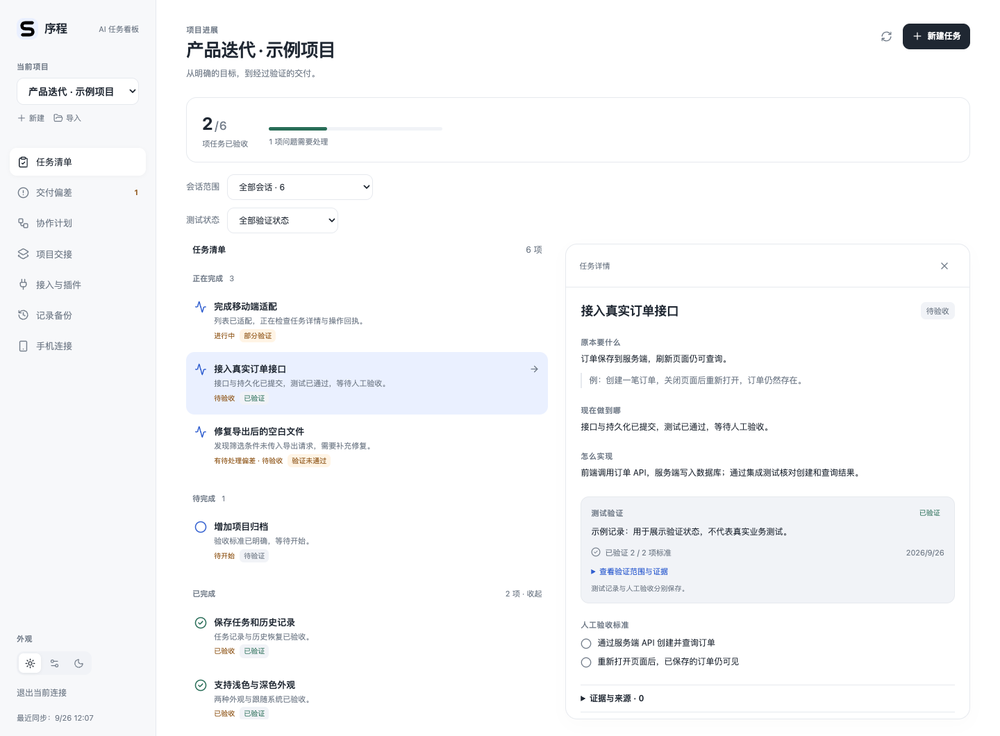
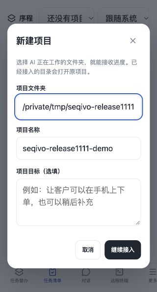
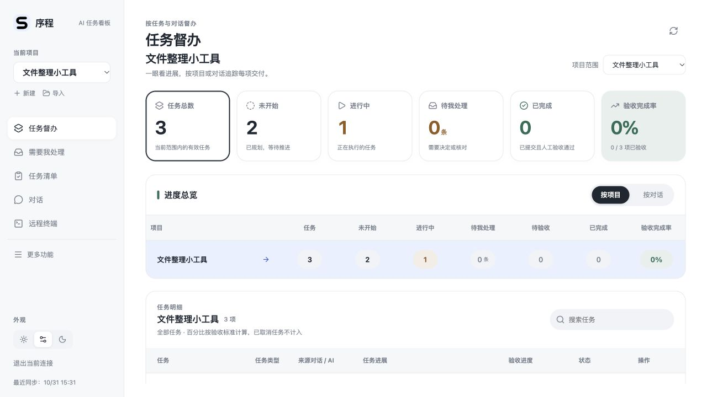
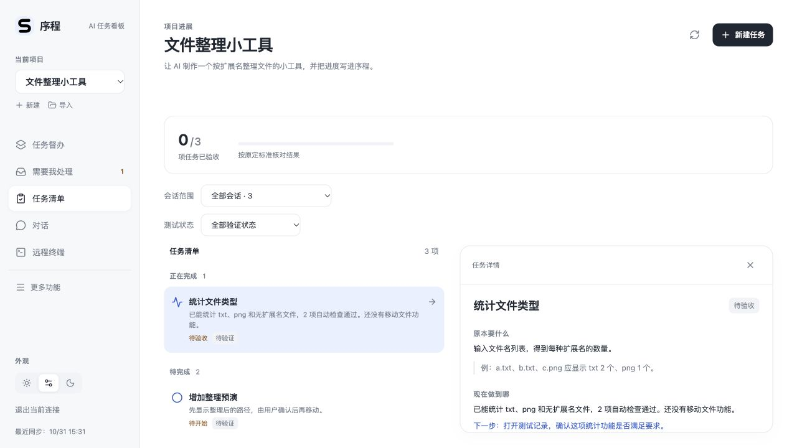
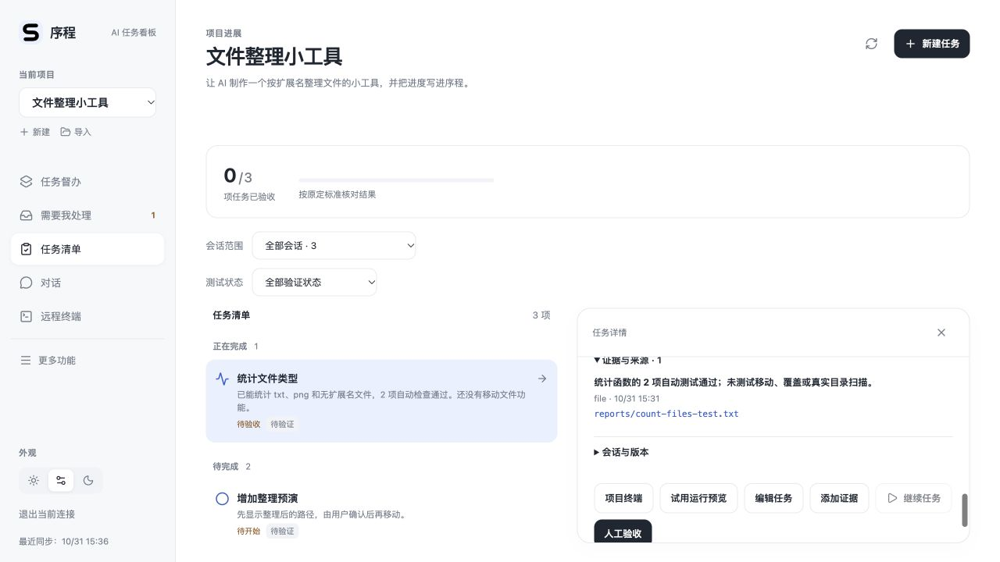

<div align="center">
  
  <h1>Seqivo · 序程</h1>
  <p><strong>Keep AI progress and delivery evidence visible.</strong></p>
  <p>Track project tasks, progress, evidence, and human acceptance across AI conversations.<br />Local-first: you choose what the AI does and decide whether the result is complete.</p>
  <p><a href="README.md">简体中文</a> · <strong>English</strong></p>
  <p><code>Release v0.4.1-r2 · App 0.4.1</code> · <code>Mac · Android</code> · <a href="LICENSE">PolyForm Noncommercial 1.0.0</a></p>
  <p><a href="#install">Install</a> · <a href="#first-project">First project</a> · <a href="#optional-connections">Optional connections</a> · <a href="#documentation">Documentation</a></p>
</div>



*Screenshots use a separate, fictional demo project. They are not user project data or a guarantee of product outcomes. The UI shown is in Chinese.*

## What is Seqivo?

Projects often span many conversations and AI tools. Seqivo keeps a shared task list for the original goal, completed work, next steps, evidence, and acceptance decisions, so a new conversation can continue with the same project context.

Seqivo does not automatically read every AI chat, and an AI saying “done” does not count as acceptance. An AI can report progress and attach evidence. Test status and human acceptance are recorded separately, and you check the current result.

**The local file-reporting workflow requires no Hub account, AI API key, or project business API/database.** Seqivo stores its own board data on the computer. Files under `.taskboard/` let the AI and board exchange project context, progress, and receipts. You choose whether to use an AI tool and manage its sign-in there.

### Core features

| Feature | What you can do |
| --- | --- |
| Projects and tasks | Track goals, progress, blockers, next steps, and acceptance criteria; see completion based on human acceptance. |
| Evidence and verification | Keep delivery evidence and record test coverage and results separately from human acceptance. |
| Needs attention | Review items awaiting acceptance, blocked, or needing a decision, then make the decision yourself. |
| Conversation handoff | Continue work in a new AI conversation using the project context and task snapshot. |
| Appearance and connections | Use light, dark, or system appearance; optionally connect the Codex execution plugin, phone Hub, or SSH/tmux terminal. |

The Codex execution plugin, phone Hub, and SSH/tmux are optional connections that need separate setup. Validation coverage differs by platform and connection; see the notes below.

## Install

| Platform | Download and setup |
| --- | --- |
| Mac Apple silicon | [ZIP package](https://github.com/Autumnpoem/seqivo-public/releases/download/v0.4.1-r2/Seqivo-0.4.1-macos-arm64.zip); first-launch details below. |
| Android 8.0+ | [Signed APK](https://github.com/Autumnpoem/seqivo-public/releases/download/v0.4.1-r2/Seqivo-0.4.1-android.apk); [phone setup guide](docs/mobile-install.en.md). |
| iPhone | Safari / Home Screen web app; [setup steps](docs/mobile-install.en.md#3-iphone-safari-and-home-screen). No native iOS package. |
| Windows 10/11 x64 | No published installer yet; [complete dependencies-to-NSIS build guide](docs/build-windows.en.md). |
| Ubuntu 24.04 LTS x64 | No published installer yet; [complete dependencies-to-deb/AppImage build guide](docs/build-ubuntu.en.md). |

**Phones require your own HTTPS Hub.** There is no built-in public service address; installing the APK does not deploy a server or sync a project. See the [phone guide](docs/mobile-install.en.md).

### Mac with Apple silicon

The release is **v0.4.1-r2**, with app version **0.4.1**; it reuses the identical Mac package from v0.4.1. Open the [latest Release](https://github.com/Autumnpoem/seqivo-public/releases/latest), download the Mac Apple Silicon ZIP, extract it, move `序程.app` to Applications, and open it.

This package uses a local ad-hoc signature. It is not signed with an Apple Developer ID or notarized. macOS may warn that it cannot verify the developer. Only continue after confirming that the download source is trusted, and follow the prompt in System Settings → Privacy & Security. Do not disable Gatekeeper or lower system security. There is no Intel Mac package at this time.

### Windows, Ubuntu, or other systems

There is no Windows or Ubuntu installer at this time. Follow the [Windows guide](docs/build-windows.en.md) or [Ubuntu guide](docs/build-ubuntu.en.md) to build and install locally, or run the local web board from source. Native desktop builds are also configured, but Windows, Ubuntu, and Intel Mac native installation and full interaction have not all been validated. A build configuration does not mean the platform has passed full release validation.

The source web path requires Git, [Node.js 24 or later](https://nodejs.org/), and [pnpm 11](https://pnpm.io/installation):

```sh
git clone https://github.com/Autumnpoem/seqivo-public.git
cd seqivo-public
pnpm install --frozen-lockfile
pnpm build
pnpm server
```

On the same computer, open <http://127.0.0.1:4317>. On first use, read the local `owner` access token from `.runtime/access.json` in the source directory and enter it on the board login screen. Do not put the token in a URL, chat, or public file. This runs a local service and database; no external business database is required. Stop the service with `Ctrl+C` in its terminal. See the [desktop build guide](docs/desktop-build.md) for source and native build details.

<a id="ai-tools"></a>

### Optional: install and sign in to an AI tool

If you already use Codex, Claude, or another AI, paste Seqivo’s prompt into that existing conversation; you do not need to install a CLI. If you need an AI tool, install and sign in using its official instructions. The AI account is separate from Seqivo; **never enter your AI password or access token in Seqivo**.

- **Codex CLI (macOS/Linux):** Follow the [official CLI guide](https://learn.chatgpt.com/docs/codex/cli) and run its installer: `curl -fsSL https://chatgpt.com/codex/install.sh | sh`. In your project folder, run `codex`. On first launch, choose **Sign in with ChatGPT** or another available sign-in method. For Windows and other systems, follow the matching installation steps in the official guide.
- **Claude Code:** Anthropic currently recommends the native installer. In a macOS, Linux, or WSL terminal, run `curl -fsSL https://claude.ai/install.sh | bash`, then open a new terminal and check the installation with `claude --version`. In your project folder, run `claude` and follow the browser sign-in prompts. You can use a Claude subscription, Anthropic Console (prepaid credits), or a supported cloud provider. For Windows and other systems, follow the matching steps in Anthropic’s [official Quickstart](https://code.claude.com/docs/en/quickstart).

You can start either CLI directly in the project folder. **For file reporting, you do not need to configure Seqivo’s Codex execution plugin; just copy the prompt.** To start or control Codex from Seqivo, see the optional connection section below.

## Personal setup

Start by choosing a project folder; no server address or API key is required. Use **Appearance** at the bottom of the desktop sidebar to choose light, system or dark mode; the mobile layout offers this selector at the top. If macOS asks Seqivo to access the Documents or Desktop folder containing your project, allow that specific folder; Full Disk Access is not required. Persistent AI reporting instructions, execution plugins and phone access can be enabled later.

## Your first project

These steps describe the installed Mac app. The source web version also works; enter the full path to the project folder manually.

### 1. Select the folder the AI is using

Click **新建** (“New”) in Seqivo’s sidebar and select the real folder containing the code. Seqivo fills in the project name from the folder name; you can change it. The project goal is optional. Click **继续接入** (“Continue setup”) to open **项目接入** (“Project connection”). If that folder is already linked to a project, Seqivo opens the existing project and keeps its tasks.



*The folder shown is isolated demo data. Select the same folder that the AI actually reads and edits; do not copy the example path.*

The basic file workflow does not require an AI execution plugin. Seqivo prepares `.taskboard/REPORTING.md`, project context, and a task snapshot in the project folder. These files are generated by Seqivo; do not edit `tasks.json` or `CONTEXT.md` directly to update the board.

### 2. Send the reporting prompt to your current AI

In **项目接入** (“Project connection”), check the folder path. When the prompt is ready, click **复制提示词** (“Copy prompt”) and paste it into the Codex, Claude, or other AI conversation that is already working on this project. The AI must have read/write access to this local folder; a chat-only website cannot access it merely by receiving this prompt. Seqivo does not start the AI for you. The prompt asks the AI to read the project instructions, context, and current tasks before reporting actual progress.

If there are no tasks yet, tell the AI the outcome you want and how to judge completion, then ask it to create tasks under the project instructions. Or create tasks in Seqivo’s task list. For example, paste this request into an empty project folder to try a local tool that needs no business API or database:

> First read the project reporting instructions. Create three tasks for a local file-extension counter: count file types, preview the counts, and add tests for handling duplicate names. Do not move, overwrite, or delete files. Define a goal and acceptance criteria for each task; implement the first task and run the tests that are actually available. Report progress, evidence, and next steps using the project instructions. Do not claim checks passed if you did not run them.

Start with a clear goal and acceptance criteria so later reports have specific work to refer to.

### 3. Confirm the report arrived and open the task

The AI writes a progress event to `.taskboard/inbox/`. Seqivo reads and processes it, writes the result receipt to `.taskboard/receipts/`, and updates the board. When Project connection shows **已收到汇报** (“Report received”) with a recent received time, the progress has reached the board. Click **查看对应任务** (“View related task”) to check it. An inbox file by itself does not confirm successful receipt.



*This screenshot shows a fictional file-organizing project in an isolated demo environment. It does not mean every AI chat or project has been connected automatically.*

The AI can create tasks, update progress, and submit evidence. If an event is rejected, expand the technical details and ask the AI to read the reason and latest task before correcting and resubmitting. Do not blindly repeat an old event. If you edit the project reporting instructions, Seqivo preserves your version and lets you expand a comparison with the recommended text.

### 4. Review evidence and accept the work

An AI submitting “done” or test evidence means the work is ready for review; it does not mean it has passed acceptance. Open the task and check the original goal, implementation, next steps, evidence, and each acceptance criterion. You can also add an actual test report or artifact reference yourself.





*The task and test results in these screenshots are isolated demo data.*

After confirming that the current result meets the requirements, the evidence is checkable, and no issue remains open, submit a human **Pass** decision. If something is missing, choose **Fail** and describe it. Test status and human acceptance are separate records; checking off a verification item does not accept the whole task.

### 5. Continue in a new conversation

For a new AI conversation, use the same project folder and ask the AI to read `.taskboard/REPORTING.md`, `.taskboard/CONTEXT.md`, and `.taskboard/tasks.json`. These files restore the project goal, existing tasks, current progress, and next steps; they do not contain the full history of old chats.

You may also expand **Add reporting guidance for new conversations (optional)**, preview the text, and explicitly add a short block to Codex’s `AGENTS.md` or Claude’s `CLAUDE.md`. Seqivo appends the block and preserves existing file contents. It is a reminder and cannot guarantee that every AI tool will follow it. Seqivo does not edit these rule files automatically.

## How tasks become complete

| State or record | Meaning |
| --- | --- |
| Planned, in progress, blocked | Current work status; a blocked task should include a reason and next step. |
| Submitted / awaiting review | The AI reported delivery; you still need to review it. |
| Test verification | Records which criteria were tested, the result, and evidence. It does not replace human acceptance. |
| Human acceptance passed | You confirmed that the current submission meets the goal, criteria, and evidence requirements. The task then counts as complete. |

Project completion is calculated from accepted tasks, not an AI-reported percentage. If the goal or implementation changes, earlier verification or acceptance may need to be repeated.

## Optional connections

These paths are independent of local file reporting and can be configured later.

- **Codex execution plugin:** To create or control Codex execution sessions from Seqivo, install and sign in to Codex CLI on the same computer. In **Integrations and plugins**, enter the local Python and Codex paths, check the connection, and enable the plugin. Then bind the correct project folder and execution session to the task. Copying a reporting prompt does not start the plugin. Real-execution validation is limited across versions and quota cycles; this does not establish that every execution scenario has passed acceptance.
- **Phone and Hub:** To view projects across networks, you need an existing HTTPS Hub deployment. Sign in to it on the project computer and explicitly choose which projects to sync; then sign in to the same service from a phone browser. A Hub account is not needed for local file reporting, and the source web service at `127.0.0.1` does not become an internet service automatically. There is no official hosted service at this time. See the [account setup guide](docs/account-setup.md) and [Hub deployment guide](docs/deployment.md).
- **SSH and terminal:** This is separate from AI file reporting and the Codex execution plugin. It requires separate SSH host configuration and permissions. Validation differs across desktop, Hub, and platforms; see the [SSH terminal guide](docs/ssh-terminal.zh-CN.md).

## Privacy and limits

In local mode, Seqivo stores tasks and history on the current computer; it does not need to sync project data to a cloud service. If you connect to a Hub, project snapshots, task status, and explicitly authorized remote operations are sent to that Hub. Viewing conversations or running tasks also depends on the permissions you grant. Do not put passwords, tokens, private keys, or other secrets in tasks, evidence, or chat content.

Seqivo updates tasks from AI-submitted records. It does not read every chat, verify that reported content is true, or automatically prove that software works. A submitted result, a passing test, and human acceptance are separate steps.

## Documentation

- [Android installation, iPhone web app and first connection](docs/mobile-install.en.md)
- [Windows build/install](docs/build-windows.en.md) · [Ubuntu build/install](docs/build-ubuntu.en.md)
- [New-computer setup and illustrated guide (Chinese)](docs/new-computer-guide.zh-CN.md)
- [Everyday use and task acceptance (Chinese)](docs/getting-started.md)
- [Accounts, phone, and device pairing (Chinese)](docs/account-setup.md)
- [Desktop builds and data location (Chinese)](docs/desktop-build.md)
- [SSH terminal guide (Chinese)](docs/ssh-terminal.zh-CN.md)
- [Changelog](CHANGELOG.md)
- [Public source repository](https://github.com/Autumnpoem/seqivo-public) · [Report an issue](https://github.com/Autumnpoem/seqivo-public/issues) · [Download a release](https://github.com/Autumnpoem/seqivo-public/releases/latest)

## License and third-party components

Seqivo source is licensed under [PolyForm Noncommercial 1.0.0](LICENSE). It permits personal, noncommercial use within the terms of the license and **prohibits commercial use**. It is not an OSI-approved open-source license. Read the full license before use; this summary does not replace its terms. Public source availability does not grant permission to deploy, sell, or provide commercial services with Seqivo.

Third-party dependencies, bundled code, and plugins remain subject to their own licenses. This project license does not replace or change those terms; license and provenance files remain with the relevant components.

Third-party license texts, exact MPL component source locations and bundled notice locations are indexed in [NOTICE.md](NOTICE.md).
