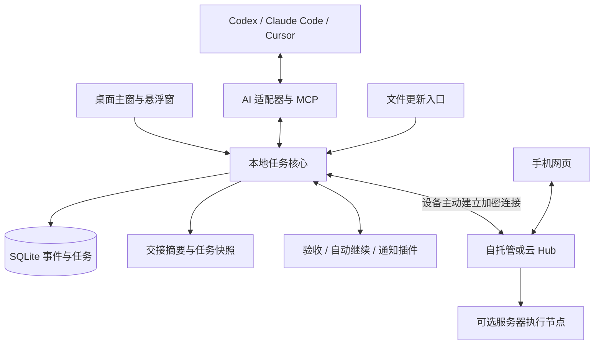

# 技术设计 v0.1

> 0.1 实际实现（2026-09-25）：Tauri 2 承载桌面窗口、托盘和 IPC；任务核心目前运行在打包的 Node 24 sidecar，使用内置 SQLite，插件桥接使用 Python。下文 Rust 领域核心、事件重放、Hub、设备配对和多 Agent 是目标架构，尚未全部落地。此选择复用同一 HTTP/文件/MCP 核心用于桌面与服务器，后续可沿用协议迁移实现。实际边界见 [验证记录](validation.md)。


这是建议架构与接口草案，尚未实现。目标是本地可独立使用，同一套任务协议也能服务自托管与供应商云。

## 1. 推荐组件

| 层 | 建议选择 | 责任与理由 |
| --- | --- | --- |
| 桌面外壳 | Tauri 2 | Windows／Ubuntu／macOS 窗口、托盘、快捷键、系统通知与凭据存储接入 |
| 用户界面 | React + TypeScript | 主窗口、紧凑窗口、手机网页共用组件和任务视图 |
| 本地核心 | Rust 独立服务 + SQLite | 唯一写入者，执行任务状态规则、插件调度、事件记录与实时推送 |
| 插件进程 | 标准输入输出 JSON-RPC | 插件可用 Python、TypeScript、Rust 等实现，保留自动继续项目现有语言 |
| 远程 Hub | 独立服务 + PostgreSQL | 设备身份、任务只读投影、命令队列、用户权限与审计 |
| 手机入口 | 响应式 Web／PWA | 避免第一版维护两套移动原生产品 |

Tauri 的跨平台能力、托盘和窗口 API 是选型依据，不代表本项目已适配：[框架说明](https://v2.tauri.app/start/)、[托盘](https://v2.tauri.app/learn/system-tray/)、[窗口 API](https://v2.tauri.app/reference/javascript/api/namespacewindow/)。Linux 托盘鼠标事件存在官方注明的限制，交互要提供菜单和主窗口入口。

Rust 会增加开发门槛，但利于桌面外壳与长期运行服务共用领域代码。若团队只熟悉 TypeScript，可在验证打包与进程生命周期后改用 Node sidecar；保持协议不变。最终选型在最小三系统打包验证后锁定。

## 2. 结构



本地核心与窗口分离。关闭主窗口后可由托盘继续运行；“退出并停止后台”与“隐藏窗口”是不同操作。服务器节点可无图形界面运行，桌面节点默认按当前用户启动，不要求管理员权限。

首版每个项目指定一个 `ownerNodeId`：此节点拥有权威任务状态。Hub 保存只读投影与远程命令，不与本地双向合并整份数据库。手机更改也是命令，必须由该节点校验后成为正式事件。节点离线则显示快照或待提交草稿。

后续迁移项目到服务器执行时，显式停写、迁移快照和事件游标、切换 owner 并增加所有权代次。未完成迁移前不能同时有两个权威节点。云托管的 Hub 不等于云端执行器。

## 3. 数据模型

| 实体 | 关键字段 |
| --- | --- |
| Project | id、目标、约束、ownerNodeId、ownerEpoch、activeBaselineId、revision |
| RequirementBaseline | id、版本、原始需求引用、交付类型、必须项、范围变更记录 |
| Task | id、parentId、requirementIds、标题、摘要、依赖、负责人、执行状态、验收状态、revision |
| AcceptanceCriterion | id、taskId、baselineVersion、内容、是否必须、验证方式、通过策略 |
| Conversation | provider、hostId、原生会话 ID、来源、关联任务；不要求导入全部聊天 |
| Run | taskId、conversationId、执行节点、开始／结束、等待原因、心跳、预算、执行租约 |
| Evidence | criterionId、产物引用、内容摘要、代码／文件版本、环境、时间、采集者、结果 |
| Review | taskId、基线版本、证据集、审查者、问题、严重性、结论类型 |
| Event | eventId、projectId、seq、来源身份、actor、taskId、expectedRevision、schemaVersion、payload |
| Command | commandId、目标节点／会话／任务、ownerEpoch、expectedRevision、TTL、授权、执行回执 |

运行状态和验收状态独立。运行可为 `planned/running/paused/blocked/submitted/failed/cancelled`；验收可为 `unverified/passed/failed/stale/waived`。`done` 是按当前基线计算的展示结论，不允许实现 Agent 直接写入。

证据不是一句“测试通过”。至少包含运行来源、检查范围和产物版本。AI 自报可以保存，但标为自报；可信验证器的身份由核心分配，不能通过文件里填写 `reviewer` 冒充。人工验收必须由具备权限的用户身份执行。

范围或实现变化后，关联验收结果置为 stale。主界面显示“需重新验证”，历史通过记录保留。取消的任务和例外接受从严格完成计数分开统计。

## 4. 写入路径与实时更新

1. 适配器、MCP 或文件入口提交规范化事件，附来源和唯一事件 ID。
2. 核心验证身份、项目范围、schema 和 `expectedRevision`。
3. 单一 SQLite 事务写入事件、更新任务投影、追加待同步记录。
4. 提交后通知本地窗口，异步同步 Hub，刷新交接快照。
5. 客户端用游标补齐丢失事件；投影可从事件重建。

冲突返回当前版本与差异，不采用无声的“最后写入覆盖”。重复事件 ID 返回之前结果。源时钟不决定事件顺序，以 owner 节点的单调序号为准；保留源时间帮助诊断。

性能目标（待实测）：本地已提交事件到界面更新 p95 小于 1 秒；健康网络下远程更新 p95 小于 3 秒；10,000 条任务不使列表失去响应。验证时报告机器与数据规模，不能直接宣传为已达到。

长任务通过适配器心跳识别活跃状态。只有文件更新时不伪造实时心跳；显示“最后报告于……”。进程退出、事件流断开、额度用尽和等待输入分开归因。

## 5. 文件协议

建议使用每项目 `.taskboard/`，实际运行数据库放用户应用数据目录，避免 Git 同步数据库。

```text
.taskboard/
  project.json          # 可选的专用导入文件，当前文件桥不会导出它
  tasks.json            # 核心导出的任务快照，只读投影
  CONTEXT.md            # 给新对话读的简洁交接
  inbox/<source>/<event-id>.json  # AI 或脚本提交的单独事件文件
  receipts/<编码后的事件路径>.json  # 成功、冲突或校验失败
```

生产者先写临时文件，再原子重命名为 `.json`；当前文件桥约每 900 毫秒检查一次，事件按 ID 去重。每事件单文件避免多个模型抢写同一个 JSON。文件桥检查大小、路径、符号链接和项目归属，导出快照同样采用原子替换。

AI 直接修改导出快照不会被当作已接受写入；更新应通过 inbox／MCP 提交。专用 project.json 导入与任务快照导出是不同格式。源文件视为低信任数据，里面的自然语言不能取得额外执行权限。

以上文件接入已有实现：文件桥定期检查 inbox、写回执，并导出 tasks.json、CONTEXT.md 与 REPORTING.md。项目接入页通过本机 owner 接口读取文件准备状态和最近真实回执；仅创建目录不会显示已收到汇报。project.json 仍属于专用导入格式，不是自动生成的项目快照；普通代码目录初次接入应在界面“新建项目”并绑定目录。具体操作和当前范围见[图文上手指南](new-computer-guide.zh-CN.md)。

## 6. 对 AI 提供的接口

MCP／本地 API 统一映射到以下领域操作（名称为本产品设计，非声称外部工具已支持）：

```text
project.get_context(projectId, tokenBudget)
task.list(projectId, scope, cursor)
task.propose(projectId, sourceConversation, tasks, expectedRevision)
task.claim(taskId, expectedRevision)
task.report_progress(taskId, runId, summary, step)
task.submit_result(taskId, runId, evidenceRefs)
review.report(taskId, baselineVersion, findings)
command.request(taskId, action, expectedRevision, idempotencyKey)
```

`get_context` 返回目标、约束、已定方案、当前任务、阻塞、相关证据、下一步与修订号；按令牌预算分层，不塞入整个聊天历史。模型开始时读取，里程碑后汇报，结束时提交剩余工作。宿主没有强制 hook 时，只能通过漏报检测和人工补录补强，不能保证 AI 每次服从提示。

需求范围修改通过专门的变更提议；执行 Agent 不能使用普通进度接口删除验收条件。任务去重先匹配稳定 ID、来源和需求关联；语义相似只生成合并建议。

## 7. 接入路线与能力声明

| 适配器 | 第一目标 | 限制 |
| --- | --- | --- |
| 通用文件 | 读背景、提交任务与结果 | 不知道聊天是否仍在运行，不能靠文件自动控制任意宿主 |
| 通用 MCP | 结构化读取和汇报 | MCP 不自动提供宿主全部会话或远程恢复权限 |
| Codex | 本程序管理的会话运行、事件、额度、继续 | 外部桌面正在使用的会话须专门验证发现、附着和并发行为 |
| Claude Code | hooks 采集 + MCP 报告 | 继续能力需要其受支持运行接口另行验证 |
| Cursor | MCP 任务读写 | 不能据此承诺从手机操作任意 Cursor 当前聊天 |

Codex 适配器优先使用本机 `codex app-server` 的 stdio。原生协议和版本先通过握手与能力测试确认，然后生成或固定 schema。使用会话 ID 恢复并开始新一轮，订阅执行事件；额度数据缺失显示未知。官方提供这些方向的接口，但需要锁定安装版本验证：[App Server](https://learn.chatgpt.com/docs/app-server)。

插件握手返回 `readTasks/writeTasks/observeRuns/resumeRuns/interruptRuns/readQuota` 等独立能力，以及支持的平台／版本。UI 据此显示按钮，不能仅凭安装成功显示“完全接入”。

## 8. 插件契约

插件清单示意：

```json
{
  "id": "autocontinue.codex",
  "version": "0.1.0",
  "protocolVersion": "1",
  "kind": "automation",
  "entry": { "command": "codex-charge-bridge", "args": ["--stdio"] },
  "permissions": ["quota.read", "task.read", "run.resume.request"],
  "subscriptions": ["run.blocked", "quota.updated", "task.cancelled"]
}
```

宿主负责生命周期、健康检查、崩溃隔离、超时、日志和事件订阅。插件可请求动作，但必须经核心校验授权、目标状态和预算。按协议主版本判断兼容；升级包含迁移、备份与回滚。凭据使用系统安全存储，不放清单或任务文件。

进程隔离不等于安全沙箱：首版只支持明确安装的可信本地插件，标明其可访问用户进程环境。真正的第三方不可信插件需要 OS 沙箱或受限运行时；在实现之前不能宣传“权限声明即可隔离任意插件”。

插件 UI 第一版采用核心提供的设置表单、状态与动作插槽，不加载任意远程脚本。可先扩展后端功能，后续再设计受限自定义界面。

## 9. 手机、自托管和云服务

三种部署模式复用协议：纯本地；用户自己部署 Hub；供应商提供 Hub 地址。每项目独立选择是否同步，默认只同步任务摘要与结果索引，不上传源代码、完整聊天或凭据。

设备从内部网络主动建立加密连接到 Hub，无需直接把电脑端口开放到公网。配对使用短时一次性码，并在已登录桌面显示目标账号／设备；手机登录后获得项目权限，设备可随时撤销。

本地 UI 到核心使用受控 IPC 或绑定 loopback 的带令牌接口；网络入口具备身份认证、来源校验和请求限流。浏览器不保存能直接控制操作系统的长期密钥。访问本地文件的产物链接通过受控下载通道，并遵守项目共享权限。

手机继续的流程：

1. 提交 `commandId + projectId + taskId + conversationId + ownerEpoch + expectedRevision + expiresAt`。
2. Hub 记录已提交，本地核心接收后核对身份、任务版本、会话状态与自动化授权。
3. 获取任务执行租约后调用适配器，返回“已接收”。
4. 收到对应 AI 开始事件才返回“正在运行”；完成事件与任务验收仍然分开。
5. 重复 commandId 返回同一个结果；超时、未知和失败明确呈现。

不宣称网络下的绝对 exactly-once。若上游没有幂等请求而连接在提交后中断，先查询运行状态进行对账；无法辨认时显示“执行结果未知”，不自动再次发送导致重复任务。暂停／停止命令也需要回执，发送不等于已经停止。

任务内容和原始来源均属于不可信输入，不能携带“跳过审批”之类的控制指令。远程操作沿用桌面既有权限，不因为来自手机就提高权限。多租户云版本还需项目隔离、配额、备份与恢复验证。

## 10. 多 Agent 协作

协调器按任务依赖图调度，以项目预算和 Agent 能力选执行器。一个可写任务同时只允许一个有效租约；代码任务使用独立 worktree 或清晰文件所有权，合并由单一集成步骤执行。运行锁用续租和 fencing token，避免网络恢复后的旧执行器继续覆盖。

角色交换结构化决策摘要、问题和证据，不必广播全部对话。评审角色不能取得实现写权限；产品基线的重大变化仍由用户或其明确预授权规则决定。跨模型共识不是正确性证明，冲突时保留不同结论及依据。

## 11. 发布与恢复

首版建议验证矩阵：Windows 11 x64；Ubuntu 24.04 LTS x64 的 X11 与 Wayland；macOS 13+ 的 Apple Silicon 与 Intel。具体最低版本要结合锁定工具链和依赖验证后调整，发布页只能列出实测通过组合。

各平台分别构建、安装测试、升级测试和签名；macOS 公证、Windows 签名、Linux 依赖与托盘差异列入发布工作。签名服务费用和证书配置由发布阶段确定。

应用重启从事务日志与 outbox 恢复，重新确认上游运行状态，再恢复计时器；不能看到旧的 running 就再次启动。定期备份数据库并做恢复演练；导出 JSON／Markdown 供迁移，附 schema 版本。

关键故障测试：原子写中断、事件重复、顺序错乱、需求版本变化、插件崩溃、RPC 挂起、电脑睡眠、双窗口同时继续、远程命令过期、断网后重复提交、错误会话 ID 和旧租约恢复。
