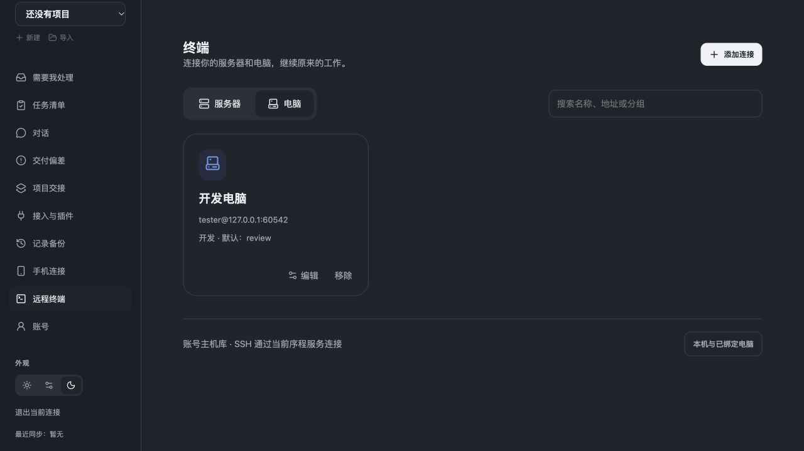
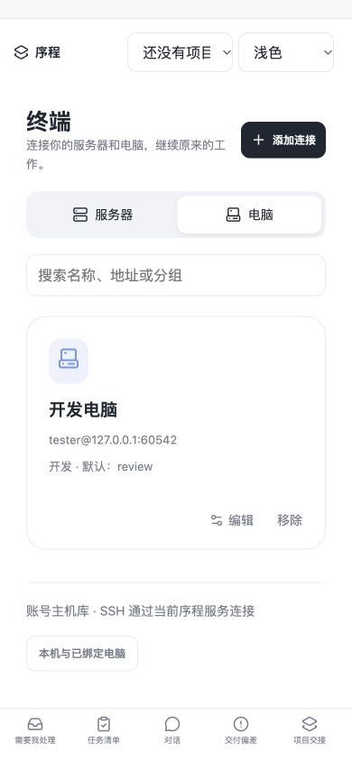

# SSH hosts and terminal

Updated 2026-10-24. Current delivery status is below; 9c5, f357c82, 144e059 and 386ddd7c records remain scoped to their respective versions. General SSH remains separate from managed AI takeover.

## Current delivery status

Candidate e5de02b replaced the production Mac app in place and is deployed to the Hub; post-deployment manifest and database/data checks passed. The initial API request timed out; the sidecar later became ready, and a manual retry then loaded the original board. Normal Command-Q/Core close and the subsequent same-data warm reopen passed without manual retry, preserving the original project and 2 projects/62 task rows. A bounded physical Android v13 OS-offline recovery and short lock/unlock check also passed against the updated Hub web bundle: the same page stayed open, then reattached to the original session after connectivity returned. Read-only checks found the markers unchanged and no input replay. Test-owned sessions/files were cleaned up. This reused the existing v13 APK; no APK rebuild or upgrade was part of the test. Other network conditions and platforms remain unverified. The Mac package is locally ad-hoc signed and not notarized. See the [e5de02b delivery status](qa/ssh-terminal/delivery-e5de02b.json) and the [historical c7095d6 Hub delivery record](qa/ssh-terminal/delivery-c7095d6.json).

A physical Android v13 check on Hub 386ddd7 used clipboard input with dedicated A/B tmux sessions: markers were written and appended, the UI switched B→A, and after Home/backgrounding a user-assisted return could read the original B session. A separate physical-device check against Hub c7095d6 set A as the default, temporarily switched to B, then manually disconnected and made a new connection that returned to A; both markers remained one line. Clearing the default was confirmed server-side, and the new-connection chooser after clearing passed. The A/B test sessions were retained at that point and have since been cleaned up after the e5de02b retest. The APK remained v13 and was not rebuilt in package625.

The 13 SSH623 callback cases cover clearing a current or missing default and showing a chooser when no default exists. On the physical device, Ctrl+Shift+M moved focus from the terminal to the session bar and opened the drawer on three attempts; direct pointer actions remain unreliable, so this does not establish support for every keyboard. Automatic SSH recovery failed on the previously installed c7095d6 during a physical Android test with Wi-Fi and cellular disabled: the SSH UI reported a connection failure and disabled terminal input; after Wi-Fi was restored, the main board recovered but SSH stayed disconnected. Screen lock was not tested. The c7095d6 offline failure remains historical for that version. On the deployed e5de02b Hub, a bounded physical Android v13 test disabled both network types, kept the page open, then restored connectivity; the client automatically reattached to its original session. Read-only checks found the marker lines unchanged and no input replay. The test reused the existing APK without rebuilding or upgrading it. The short lock/unlock check and cleanup passed; the displayed session list could remain stale after channel exit until a new connection, so no live-refresh behavior is claimed. Other network conditions and platforms are not covered. See the [offline-recovery record](qa/ssh-terminal/offline-recovery.json). The 15 backend regressions, type-check, web build and independent review belong to the older 144e059 source; the later build comparison showed distribution-only changes, but that suite was not rerun on c7095d6. See the [older delivery](qa/ssh-terminal/integration-delivery.json), [144e059 transient-recovery record](qa/ssh-terminal/transient-recovery.json), and [386ddd7c delivery record](qa/ssh-terminal/delivery-386ddd7.json), and the [offline-recovery record](qa/ssh-terminal/offline-recovery.json).

## Transient reconnect behavior

The 144e059 source passed 15 SSH-recovery/terminal/shutdown regressions, type-checking, the web build, and a scoped REVIEW607 review. These results do not claim that c7095d6 reran the suite. After a transient disconnect, the client resumes only when the original tmux session ID, tmux server identity, and host-configuration revision all match. Missing or mismatched identity has no fallback; the user must choose explicitly. A deliberate new connection still uses the host default. Manual disconnect stays disconnected, and input is never replayed. In isolated real SSH/tmux interactions, the main and review sessions each wrote one marker. In a separate isolated network-fault check, only the active WebSocket was closed abruptly: review remained selected, attach-session was observed twice, and the file marker was written once. A deliberate disconnect followed by a new connection opened the host default, main. This was not an operating-system offline or background-app test; the IAB view stayed visible. See the [144e059 transient-recovery record](qa/ssh-terminal/transient-recovery.json).

Users can add arbitrary servers and computers with a hostname/IP, port, username and password or private key. A target needs an SSH service; installing Seqivo or associating an AI task is not required.

The username and password fields are visible in the connection form. “Save and connect” starts SSH; “Save credentials” is a separate, optional choice. These are the target machine's SSH credentials, not the Seqivo account credentials.

The terminal home contains Servers and Computers, searchable host cards, editing, grouping and removal. After connecting, the main area is the terminal and the bottom selector lists that target user's tmux sessions. Users can switch, create a session, or explicitly set a per-host default. Temporary selection does not alter the default. A missing/replaced default requires choosing again. A plain Shell remains available if tmux is not installed.

The desktop connects directly from the Mac and stores hosts locally. Android/the mobile website connect through the authenticated Hub, which stores hosts per account. The Mac need not stay online for a Hub-to-server connection. A Mac browser signed into the same Hub shares the account library. The native local library and the Hub library are currently separate; local credentials are never uploaded automatically.

One SSH jump host can be selected in advanced settings. Both SSH host identities must be verified. Hub targets must be reachable from the Hub; adding a private address does not create NAT traversal. The Hub denies direct private/loopback/link-local targets by default; local desktop SSH can reach LAN hosts.

Passwords, keys and passphrases are used only for the connection unless the user explicitly selects saving. Saved secrets use AES-256-GCM, account/host binding and owner-only files. They are not returned by host APIs, written to browser storage, URLs or task records. This is **not end-to-end encryption or an OS hardware vault**: the connection gateway processes credentials and terminal contents, and a privileged gateway administrator can access them. Use a trusted Hub.

First use requires confirming the SSH host key fingerprint before user authentication. A changed key is never silently accepted. Hub SSH requires an account session; project viewer/node tokens cannot access it. WebSocket tickets are short-lived, single use and bound to the originating session. Revoking the session closes its terminal.

The client never replays terminal input after losing its connection. Input is bound to a channel generation and sequence. Closing/switching a tmux attachment does not kill its remote session. Plain Shell persistence depends on the remote SSH server.

The existing “Local and paired computers” entry retains Seqivo's original device permissions and AI handoff checks. General SSH does not claim to coordinate all external editors, shells or AI processes.

To continue work previously accessed in Termius, connect to the same host and SSH user, then select the same remote tmux session from the bottom drawer. A Termius tab or ordinary Shell is not itself a tmux session. For `tmux -L name`, enter that name in advanced settings; ordinary `tmux ls` uses `default`. Importing Termius credentials and arbitrary `tmux -S` socket paths are not supported.

The pre-merge SSH protocol suite used an isolated local `ssh2.Server`, real encrypted SSH, PTYs, and tmux; it did not cover user hosts. The earlier separate read-only OpenSSH check did not establish write access or phone UI acceptance. Later scoped physical Android tests on one user-provided OpenSSH host wrote disposable markers and checked real tmux switching, defaults and recovery; other targets and full device acceptance remain unverified. The pre-merge SSH/Hub suite passed 24 tests with no skips. Browser checks cover real file input, temporary A/B switching, explicit default changes, reconnecting to the default, editing/searching hosts, failed credentials, and light/dark 390-pixel layouts. Desktop runtime resources load SSH from an isolated copy and include the dependency license.

The pre-merge isolated branch had 40/42 checks pass in an additional Core/shutdown/managed-terminal regression set; both failures waited at the existing `return_review` flow and reproduced on the unmodified baseline. In the 9c5 integration scope, those two old tests were updated to review before confirm, and the related Core/managed regression passed 42/42 without weakening its safety conditions. General SSH does not bypass the managed handoff. The 9c5 SSH/Hub/shutdown checks passed 27/27 and backup/prior-executor checks passed 24/24, with no skips; these are not a full rerun of f357.

QA553 verifies a limited isolated native Mac flow. Android A/B writes, switching and background return have scoped evidence on Hub 386ddd7. On c7095d6, default-session set/switch/manual-reconnect and the no-default chooser passed with scope, but OS-offline automatic SSH recovery failed. Candidate e5de02b replaced the production Mac app and is deployed to the Hub; initial cold launch required one manual retry; normal quit/Core close and subsequent same-data warm reopen passed without manual retry. The bounded Android v13 OS-offline and short lock/unlock scenarios also passed using the existing APK, and test cleanup completed. Longer or different lock/background conditions, full phone acceptance, broader deployed-Hub SSH acceptance, native Windows/Ubuntu clients, and automatic desktop/Hub library sync remain unverified or unimplemented.

See the [Chinese specification and acceptance checklist](ssh-terminal.zh-CN.md) for current implementation and test scope. SSH library: [ssh2](https://github.com/mscdex/ssh2); tmux reference: [official manual](https://man.openbsd.org/tmux.1).
