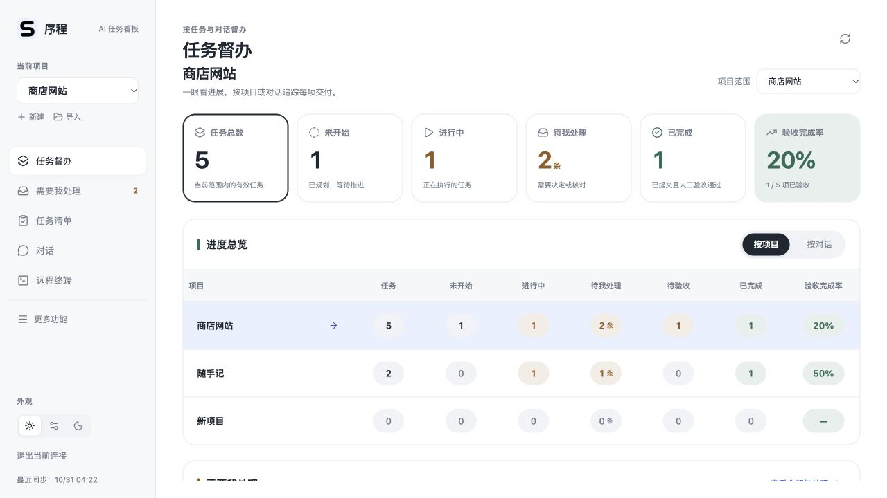
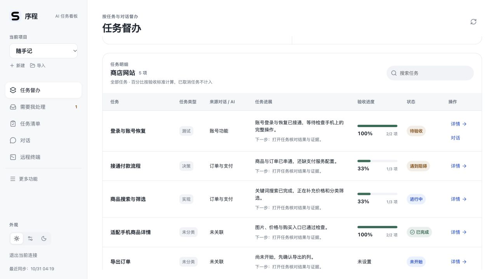

# 任务督办界面

本次改版参考用户提供的三张战役督办界面截图，按项目、任务和对话组织工作，不设置“今日督办”。首页直接展示统计、汇总表和任务明细。

## 最新界面（UI1081）

按三张参考图进一步调整为六张统计卡、项目／对话进度总览、任务明细三层。汇总表使用彩色数字标签；点击数字可直接筛选对应任务。任务明细展示类型、来源、已完成的内容、下一步、验收百分比和状态；点击任务标题即可打开详情。

手机使用紧凑统计卡和任务卡片，汇总表可横向滑动；浅色和深色使用同一布局。任务类型取自现有实现／测试／决策待办，没有记录则显示“未分类”；未新增自动猜测的业务类别。当前没有截止日期数据，因此不显示虚假的逾期统计。

以下为隔离示例数据的实际界面截图：

新版已部署私用网页，普通 Android App 重新加载网页即可看到布局；Mac 安装版尚未替换。代码、浏览器检查、安装和部署状态分别记录在 [UI1081 验证结果](supervision-ui1081-results.json)。本次未重复退出压力测试。

## 怎么看

- **统计卡**：任务总数、未开始、进行中、待我处理、已完成和验收完成率；待验收在汇总表中单列。点击统计卡或表格数字可筛选任务。
- **汇总表**：按项目或来源／执行对话汇总；点击项目／对话名称切换范围，点击数字同时筛选对应状态。可选当前项目或全部项目。
- **任务明细**：任务名称、任务类型、来源对话／AI、当前进展、下一步、验收项进度、状态和详情入口。
- **待我处理**：首页显示优先级最高的三条，进入原有收件箱完成决定和验收。
- **导航**：保留督办、任务、对话、终端等常用入口，其余功能收进“更多”。手机底部为四个常用入口和“更多”。

桌面使用表格，手机将任务明细转为卡片；手机汇总表可左右滑动，首列固定。支持浅色、深色及系统外观。

## 数字的含义

| 项目 | 计算方式 |
| --- | --- |
| 已完成 | 任务已提交，且人工验收通过。AI 自报完成不计入。 |
| 验收完成率 | 已完成任务数 ÷ 当前范围内任务总数；已取消任务不计入，空项目显示“—”。 |
| 验收项进度 | 已通过验收标准数 ÷ 标准总数。这不是代码工作量百分比，也不替代整项人工验收；没有标准时显示“未设置”。 |
| 待处理事项 | 按“条”统计；同一任务可有多条事项，筛选后的明细按关联任务展示。 |
| 任务类型 | 优先读取尚未办结的实现／测试／决策待办，其次读取可见的收件箱事项；没有记录时显示“未分类”，不根据标题猜测。 |

手机快照有未同步事项时显示缺项提示。被隐藏的执行会话不会合并为一个假会话；只有来源记录、没有执行绑定的任务不显示执行对话按钮。私密事项继续遵循原有可见性规则。

## 本轮验证与交付范围

构建、独立代码复审和隔离浏览器布局核对已完成。核对包括项目／对话筛选、跨项目详情跳转、搜索、缺少验收标准、浅色／深色、手机卡片与滚动、更多菜单及 Escape 关闭。14 个受导航调整影响的现有 E2E 文件已更新并通过语法检查，未重跑整套 E2E。

Mac 候选复用原有 Node 和后端，除网页资源外运行时资源一致，签名验证通过。最终安装和启动记录见 [本轮结果](supervision-dashboard-test-results.json)。浏览器检查使用可丢弃展示数据，不是新增真实 AI 或 SSH 执行测试；此次不重复退出压力测试，不将实体手机、线上 Hub、Windows 或 Ubuntu 记为新版本已验证。

## 网页和安卓更新

2026-10-31，新版已同步到私用网页。手机网页刷新后可看到新布局；普通 Android App 重新加载网页即可，不需要为这次布局改版重装 APK。登录后直接进入“任务督办”。服务器后台未重启，原任务、账号和执行记录保持。

普通 v13 App 在 Android API 35 模拟器中已核对首轮新版的登录、统计、筛选、滚动和详情。随后补上两处修复：

- **按来源对话分组**：同一来源的跨项目任务可归在一起，不同来源分开。手机只接收匿名分组标识，不传原始来源工具、会话 ID 和名称。旧版电脑未提供此信息时显示“来源信息未同步”。
- **详情打开位置**：从督办打开任务时重置滚动位置，先看到任务标题，不沿用前一页中下部的位置。

修复版通过构建、独立审查、25 项后台检查和 390 像素手机网页检查。网页与 Hub 接收端已更新；Mac 修复包已构建签名，但电脑锁屏，尚待原位安装。安装并同步后，手机才会收到新的来源分组。安卓 App 对这两处修复的复测仍待完成；实体手机未在这一版重测。

2026-10-31 交付补充：Mac 修复已合入单一 DELIVERY1074 候选，同时包含最近的终端底层修复；签名和包内 14 项检查通过，另 1 项 Linux 专属检查在 Mac 跳过。候选尚未安装，现用仍为 UI1066。线上已做只读复查，无需再次部署或重启；Android APK 不变，新版分组和详情的 App 复核仍待完成。详见[当前交付状态](current-delivery-status.json)。

2026-10-31 APP1079：三张参考图对应的统计、项目／对话汇总和任务明细已再次核对；同时补上任务、对话到项目终端及返回证据页的入口。私用网页已更新，14 个当前网页文件及访问限制核对通过，后台未重启、防火墙保持开启。Mac 尚未包含本次新入口，普通安卓 App 未新增复测记录。见[任务终端说明](task-terminal-navigation.md)。
